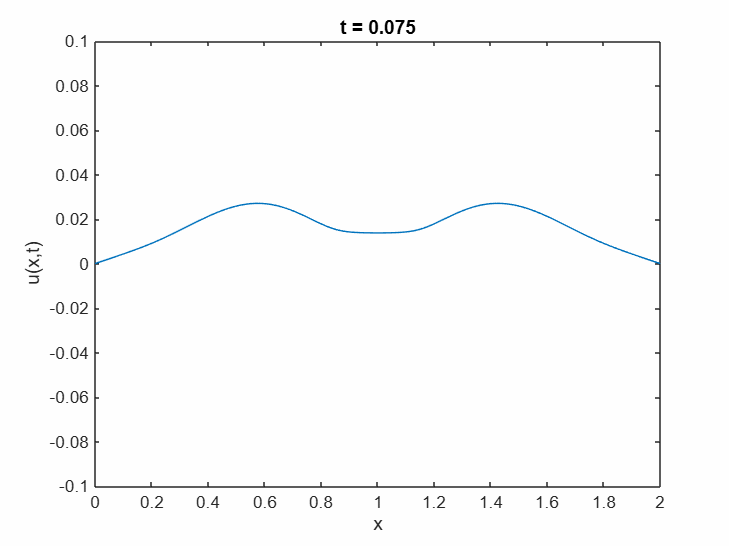
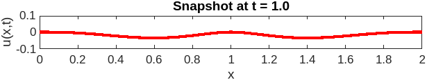
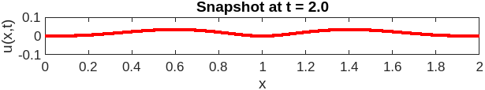
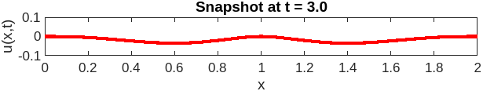
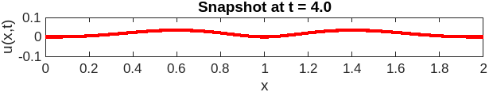

# Vibrating String Equation — Separation of Variables and Numerical Simulation

An independent university project solving the one-dimensional wave equation for a
plucked string analytically, by separation of variables and Fourier series, and then
simulating the resulting motion in MATLAB.

Course project for *Differential Equations and Applications*, Faculty of Mathematics
and Informatics, Sofia University "St. Kliment Ohridski", summer semester 2024/25.



---

## The problem

The motion of a string of length `L = 2`, released from rest in a given initial shape
and held fixed at both ends, is modelled by the initial–boundary value problem

```
u_tt = 4 u_xx,                                   t > 0,  0 < x < 2

u(x, 0) = ⎧ x³(1 − x)²,        x ∈ [0, 1]
          ⎩ (2 − x)³(x − 1)²,  x ∈ [1, 2]

u_t(x, 0) = 0,                                   0 ≤ x ≤ 2

u(0, t) = u(2, t) = 0,                           t ≥ 0
```

Here `u(x, t)` is the transverse displacement of the string at position `x` and time
`t`, and the wave speed is `a = 2`. The initial profile is a piecewise-polynomial
"plucked" shape, symmetric about the midpoint `x = 1`; the string starts at rest and
the endpoints are clamped for all time.

## Method

**Separation of variables.** Seeking solutions of the form `u(x, t) = X(x)T(t)` and
substituting into the equation separates it into two ordinary differential equations
coupled by a separation constant.

**The Sturm–Liouville problem.** The spatial factor must satisfy

```
X″(x) + λX(x) = 0,     X(0) = X(L) = 0
```

which is a regular Sturm–Liouville problem. It has non-trivial solutions only for the
eigenvalues

```
λ_k = (kπ / L)²,        k = 1, 2, 3, …
```

with corresponding eigenfunctions

```
X_k(x) = sin(kπx / L)
```

**The time factor.** For each eigenvalue, the temporal factor satisfies
`T″ + a²λ_k T = 0`, giving

```
T_k(t) = A_k cos(kπat / L) + B_k sin(kπat / L)
```

**Superposition and the coefficients.** Summing the modes gives

```
u(x, t) = Σ sin(kπx / L) · [ A_k cos(kπat / L) + B_k sin(kπat / L) ]
          k≥1
```

The initial velocity is zero, so every `B_k = 0` and the solution is a standing-wave
superposition with no travelling component. The remaining coefficients are the Fourier
sine coefficients of the initial profile `φ(x)`:

```
A_k = (2/L) ∫₀^L φ(x) sin(kπx / L) dx
```

which, because `φ` is defined piecewise, splits into two integrals over `[0, 1]` and
`[1, 2]`. These are evaluated numerically in the code.

## Simulation

The series is truncated at its **40th partial sum** and evaluated on a uniform grid of
step `0.01` over `x ∈ [0, 2]`, animated for `t ∈ [0, 5]`. Forty modes are far more than
the shape requires — the coefficients decay quickly — so the truncation error is not
visible at the plotted scale.

The animation shows the characteristic behaviour of a clamped string released from
rest: the initial profile splits into two symmetric disturbances that travel outwards,
reflect off the fixed endpoints with inverted sign, and recombine periodically. With
`a = 2` and `L = 2` the motion is periodic with period `2L/a = 2`.

Four snapshots at `t = 1, 2, 3, 4`:

| | |
|---|---|
|  |  |
|  |  |

## Running it

Requires MATLAB (no toolboxes beyond the base product; `integral` is used for the
Fourier coefficients).

```matlab
>> string_vibration
```

This opens the animation window, then a second figure with the four snapshots.

## Files

| Path | Contents |
|---|---|
| `string_vibration.m` | MATLAB source: coefficients, truncated series, animation, snapshots |
| `figures/animation.gif` | Animation of the string over `t ∈ [0, 5]` |
| `figures/snapshot_t*.png` | Snapshots at `t = 1, 2, 3, 4` |
| `report/project_report_bg.pdf` | Full written report, including the analytic derivation (in Bulgarian) |

## Author

Yulian Lyutskanov 

